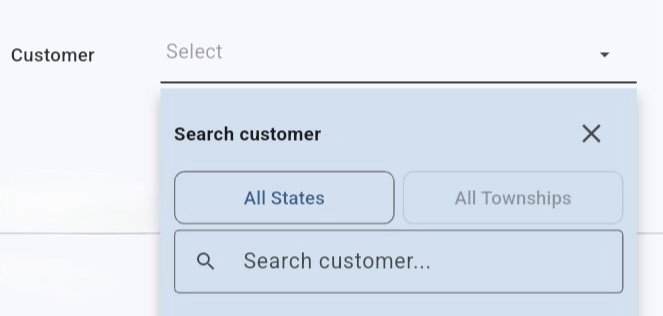

# Triple Dropdown Search

A customizable Flutter dropdown with three-level cascading filters, asynchronous search, pagination, and multi-selection.

## Preview

## Platform Support

Triple Dropdown Search is a pure Flutter widget package.

| Platform | Support |
|----------|---------|
| Android  | ✅ |
| iOS      | ✅ |
| Web      | ✅ |
| Windows  | ✅ |
| macOS    | ✅ |
| Linux    | ✅ |

No platform-specific native configuration is required.

## Features

- Three-level cascading filters
- Single and multi-selection
- Asynchronous search
- Pagination
- Custom item builder
- Customizable popup appearance
